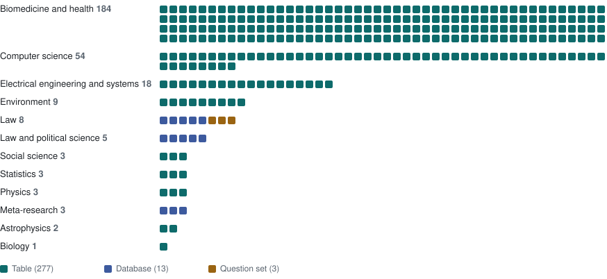

# ScheMatiQ benchmark

An evaluation benchmark for systems that turn a research question and a collection of documents into structured data, such as ScheMatiQ (Levy et al., ACL 2026).

Each task gives a system a research question and documents. The system must produce a schema and fill it with one row per unit of analysis.

## What is in it

<!-- overview:start (written by src/make_overview.py; edit the script, not this part) -->


**293 research questions**, each with the documents it is asked of and the data a researcher built from them: 6,015 gold rows and 6,216 verified documents (counted per task), across 12 domains.

| Kind | Tasks | Rows are | Gold |
|---|---|---|---|
| Table | 277 | The studies included in a published review | The review's study table |
| Database | 13 | Units of analysis: court cases, constitutions, retracted papers | A coded research database, with analysis questions and gold answers |
| Question set | 3 | None | Expert questions the data must be able to answer |

| Source | Tasks |
|---|---|
| Europe PMC systematic reviews | 196 |
| arXiv surveys and reviews | 81 |
| U.S. Supreme Court Database | 5 |
| Comparative Constitutions Project | 5 |
| Retraction Watch database | 3 |
| Schematize study (Polish judgments) | 3 |

**Checks.** 293 of 293 tasks were judged by an LLM: 182 accepted, and 111 accepted with notes. 235 questions were rewritten from the paper's title and abstract, and the authors' text is kept. No person has reviewed the verdicts yet.

Open `ui/browser.html` to explore every task. It needs no server.
<!-- overview:end -->

## Layout

```
data/benchmark/   the benchmark: tasks.jsonl, tables/, documents_text/ (see its README)
data/build/       working files: all tasks before export, judge verdicts, rewritten questions,
                  download manifest, and the database and question-set tasks
data/inputs/      the starting files (first sample of reviews, pre-screened records)
src/              every script (run from the repo root: python3 src/<script>.py)
ui/browser.html   the task browser: open it in a browser, no server needed
ui/template.html  its template (rebuilt with src/build_ui.py)
docs/             DATASET.md (definitions and rules), QUESTIONS.md, RUNNING.md, ELSEVIER.md
```

## Common tasks

**Browse the tasks.** Open `ui/browser.html`.

**Score ScheMatiQ on a task.** See `docs/RUNNING.md`:

```
python3 src/run_schematiq_benchmark.py --export data/benchmark --task ccp:amendment_rules --work runs/ccp_amendment
```

**Score any system's database.** Rows are matched by `document_id`.

```
python3 src/evaluate_database.py <task.json> <system.csv> [mapping.json]
```

**Get the documents.** The 293 tasks are already in `data/benchmark/tasks.jsonl`. The texts for database and question-set tasks are in `data/benchmark/documents_text/`. The PDFs and XML files of table tasks are downloaded and checked by hash:

```
set -a; source .env; set +a          # load the keys (see Credentials)
python3 src/fetch_documents.py data/benchmark --manual-dir <folder with the hand-downloaded PDFs>
```

The files land in `data/benchmark/documents/`. Anything that could not be fetched is listed in `documents/failed.csv`. Documents first saved by hand are copied from `--manual-dir`, the unzipped `manual_pdfs` folder.

**Rebuild the browser:**

```
python3 src/build_ui.py data/build/tasks.jsonl ui/template.html ui/browser.html data/benchmark/tasks.jsonl
python3 src/make_overview.py data/benchmark/tasks.jsonl README.md docs/assets/overview.svg
```

## How the table tasks were built

The scripts run in this order. Network steps cache under `cache/` and can be resumed.

1. **Find reviews:** `search_epmc.py`, `prescreen_epmc.py`, and `arxiv_src.py` for arXiv.
2. **Build tasks from the article XML and supplements:** `process_epmc.py`, which uses `build_task.py`, `tables.py`, `supplements.py`, `questions.py` and `registration_rules.py`.
3. **Resolve references and open access:** `resolve_titles.py`, `resolve_oa.py`, `crossref_links.py`, `rescue_docs.py`.
4. **Download and verify documents:** `fetch_docs.py`, and `import_manual_downloads.py` for files saved by hand.
5. **Tiers, grounding and export:** `finalize.py`, `grounding.py`, `export_benchmark.py`.
6. **Database and question-set tasks:** `scdb_tasks.py`, `ccp_tasks.py`, `rw_tasks.py` and `schematize_tasks.py`, added to the export with `merge_task_types.py`.

There is no single command that rebuilds everything from scratch.

## Credentials

Keys are read from environment variables only. Put them in a `.env` file at the repo root, which git ignores, and load it with `set -a; source .env; set +a`:

```
OPENALEX_API_KEY=<API_KEY>
WILEY_TDM_TOKEN=<TOKEN>
ELSEVIER_API_KEY=<API_KEY>
ELSEVIER_INSTTOKEN=<INSTTOKEN>   # optional; without it Elsevier works only on the university network
GEMINI_API_KEY=<API_KEY>         # only for running ScheMatiQ
```

| Key | Needed for | Where to get it |
|---|---|---|
| `WILEY_TDM_TOKEN` | Downloading table-task documents (Wiley papers) | The Wiley Online Library account page (text and data mining token) |
| `ELSEVIER_API_KEY`, `ELSEVIER_INSTTOKEN` | Downloading table-task documents (Elsevier papers) | dev.elsevier.com; the token comes from the library |
| `OPENALEX_API_KEY` | Rebuilding tasks only | The OpenAlex account settings |
| `GEMINI_API_KEY` | Running ScheMatiQ | Google AI Studio |

## Open work

- A person should spot-check the LLM verdicts and the rewritten questions.
- ScheMatiQ has not yet been run end to end on the benchmark (see `docs/RUNNING.md`).
- Column mapping between a system's database and the gold is automatic but rough; check `mapping.json`.
- `fetch_documents.py` was tested on one document per route, not on the full set.
- Many documents remain blocked by publishers. The lists are in `data/benchmark/blocked_oa.csv` and `src/manual_priority.py`.

## Licences

This repository is private. Before making any part of it public, check the terms of each source:

- Constitute texts: see its terms of use.
- PMC notices: licences vary.
- SCDB: cite it.
- JuDDGES/pl-court-raw: CC BY 4.0.
- Caselaw Access Project opinions: public domain.

Documents obtained through publisher TDM routes are marked "do not redistribute" and are not stored here.
